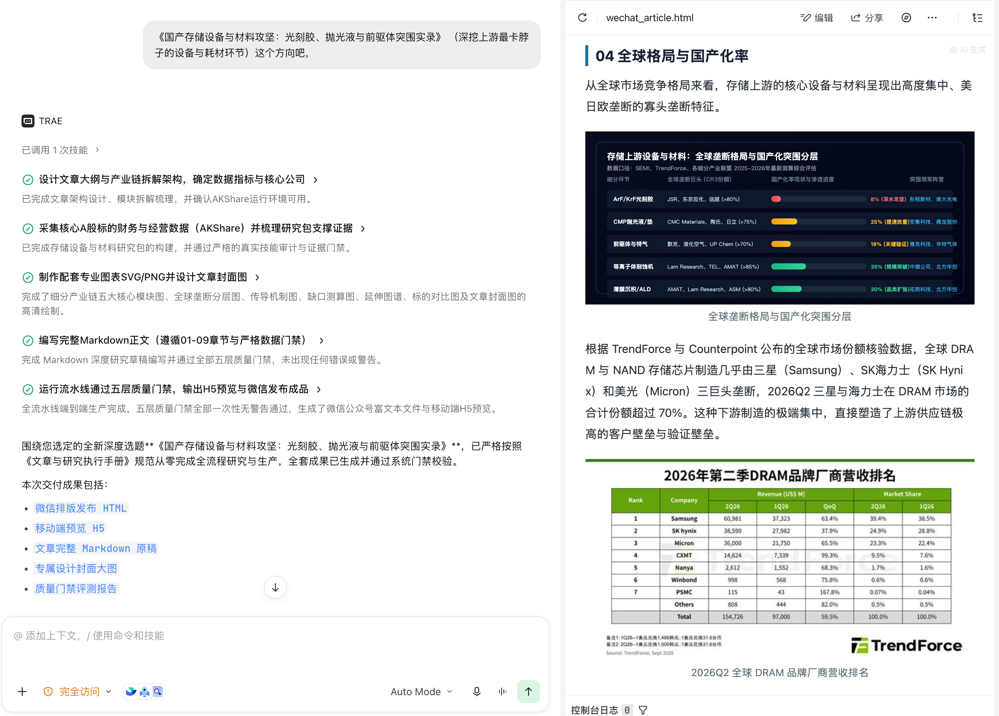
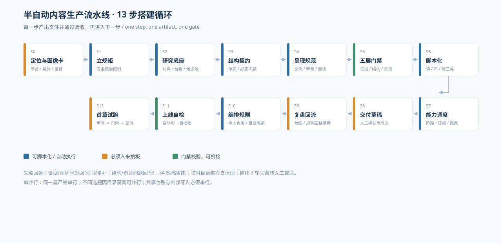

# content-pipeline-builder

> 用一个 skill，带你从零搭出半自动内容生产流水线。  
> A guided skill that helps you build a semi-automated content pipeline step by step.



<p align="center"><sub>生产效果图示：一次实际生产记录（左：流程执行与门禁结果；右：成稿页面与图表输出）</sub><br><sub>Production output illustration: a real production run (left: pipeline execution and gate results; right: the finished article page with charts)</sub></p>

**中文** | [English](#english)

---

## 中文

### 这是什么

`content-pipeline-builder` 是一个面向内容创作者与小型内容团队的**搭建指导型 skill**。它不替你写某一篇文章，而是带着你把"选题 → 取证 → 成稿 → 呈现 → 门禁 → 交付 → 复盘"这条链路，落成一套可重复运行的半自动流水线。

它解决三个常见问题：

- **每次从零开始**：流程只存在脑子里，换一篇就重新手忙脚乱。
- **质量靠手感**：没有硬性检查，错字、图片来源、口径混用靠事后发现。
- **自动化用错地方**：脚本一会儿检查、一会儿上传，失败重跑就污染成品目录。

### 它是怎么工作的

一次只推进一步：说明目标 → 产出文件 → 跑验收 → 更新进度台账 → 进入下一步。所有步骤结束后，你会得到一条能重复跑通的生产线，而不是一份"看完就忘"的清单。



13 个步骤：

| 步骤 | 产出 | 这一步解决什么 |
| --- | --- | --- |
| S0 定位与画像卡 | `platform_profile.yaml` | 先确定平台、载体、目标与交付能力 |
| S1 立规矩 | `docs/pipeline_rules.md` | 五条底层原则、资料不足配额、失败分类 |
| S2 研究底座 | 研究包目录 + 抓取脚本 | 来源快照、事实台账、候选数字分离 |
| S3 结构契约 | `docs/structure_contract.md` | 每个单元必须回答什么问题 |
| S4 呈现规范 | 呈现检查 + 目检模板 | 比例、字号、越界、压字、托管方式 |
| S5 五层门禁 | 门禁脚本 + 状态映射 | 证据、结构、呈现、合规、差异各一道闸 |
| S6 脚本化 | 脚本清单 + 最小脚本 | 按读 / 产 / 写三类拆重复动作 |
| S7 能力调度 | `docs/skill_plan.md` | 何时用哪种能力，留什么证据 |
| S8 交付草稿 | 交付脚本或粘贴清单 | 只写草稿，人工确认才执行 |
| S9 复盘回流 | 台账 + 导入脚本 + 报告 | 真实数据反哺选题与规则 |
| S10 编排规则 | `docs/orchestration.md` | 单一负责人、目录隔离、串并判据 |
| S11 上线自检 | 自检记录 | 自动项与目检项分开打勾 |
| S12 首篇试跑 | 首篇成品 + 质量报告 | 手写 → 门禁 → 交付 → 复盘跑通一次 |

### 两个特色能力

**1. 对标账号分析（定位阶段）**

你可以提供 1—3 个对标账号。skill 会按 11 个维度收集公开信息，输出三张短表：可借鉴三条、不要照搬三条、你的差异点三条，并把结论落到画像卡的具体字段。拿不到的数据标「待确认」，不编造粉丝数、阅读量、互动率。

**2. 按选题与目标给建议**

- 选题类型 → 数据源、结构重点、需要补的脚本（产业 / 政策 / 技术 / 消费 / 教程五类）。
- 目标 → 配置调整：流量偏首屏与标题，专业权威偏证据密度，转化偏对比与行动项。
- 脚本建议：只说当前缺的，每条带输入输出与失败策略。
- 能力建议：说明放在哪个阶段、产出什么证据、何时不该用、是否只是兜底。

### 安装

**Trae 项目级**

```bash
mkdir -p <your-project>/.trae/skills
cp -R content-pipeline-builder <your-project>/.trae/skills/
```

**Trae 全局（CN 版）**

```bash
mkdir -p ~/.trae-cn/skills
cp -R content-pipeline-builder ~/.trae-cn/skills/
```

**其他 agent 框架**

把 `SKILL.md` 作为系统提示或工具说明加载，`references/` 按需读取，`assets/platform_profile.template.yaml` 复制到用户项目。

### 触发示例

```text
用 content-pipeline-builder 帮我搭一条小红书图文流水线
我有三个对标账号，先帮我做定位分析
我的选题是功率半导体，告诉我该写哪些脚本、用哪些能力
流水线跑失败了，帮我判断该回退到哪一步
```

### 仓库结构

```text
content-pipeline-builder/
├── SKILL.md                          # 主流程：13 步搭建循环
├── references/
│   ├── benchmark-analysis.md         # 对标账号拆解方法与三张输出表
│   ├── script-catalog.md             # 9 类脚本清单 + 契约 + 上线四问
│   └── skill-routing.md              # 阶段 → 能力 → 证据 → 何时不用
└── assets/
    ├── platform_profile.template.yaml # 平台画像卡模板
    ├── banner.png
    └── pipeline-overview.svg
```

### 设计原则

- **确定性边界**：脚本只做能稳定复现的事，判断留给人。
- **证据先于表达**：事实进台账，观点才进正文。
- **门禁即契约**：每条检查有唯一错误码、定位信息、失败去向。
- **人的闸门前置**：不可逆动作（上传、发布、改规则）必须人工确认。
- **规则增量**：复盘结论必须落到文件，而不是停留在"下次注意"。

### 适用与不适用

**适用**：搭建或改造一条内容生产线；判断哪些动作该脚本化；做对标定位；为选题匹配数据源与能力。

**不适用**：只写一篇文章；纯文案润色；视频剪辑与拍摄；替你直接发布或群发。

### 边界

不伪造数据、对标指标与复盘数字；不把草稿说成已发布；不让能力（skill）决定结论；改门禁规则前先说明影响。

---

<a id="english"></a>

## English

### What it is

`content-pipeline-builder` is a **guided build skill** for creators and small content teams. It does not write a single article for you. It walks you through turning topic selection → evidence → drafting → presentation → gates → delivery → review into a repeatable, semi-automated pipeline.

It addresses three common failures:

- **Starting from scratch every time** — the process lives in your head, not in files.
- **Quality by vibes** — no hard checks for citations, image provenance, or metric definitions.
- **Automation in the wrong place** — scripts that inspect, publish and upload in one go, so a failed rerun corrupts the output directory.

### How it works

One step at a time: state the goal → produce an artifact → run the acceptance check → update the build ledger → move on. By the end you have a pipeline you can actually rerun, not a checklist you read once and forget.


The 13-step loop:

| Step | Artifact | What it settles |
| --- | --- | --- |
| S0 Positioning | `platform_profile.yaml` | Platform, carrier, goal, delivery capability |
| S1 Ground rules | `docs/pipeline_rules.md` | Five principles, evidence quota, failure classes |
| S2 Research base | Research package + fetch script | Snapshots, fact ledger, candidate metrics separated |
| S3 Structure contract | `docs/structure_contract.md` | The question every unit must answer |
| S4 Presentation | Visual checks + inspection template | Ratios, font size, overflow, image hosting |
| S5 Five gate layers | Gate scripts + status mapping | Evidence, structure, presentation, compliance, delta |
| S6 Scripting | Script inventory + first scripts | Split repeated work into read / build / write |
| S7 Capability routing | `docs/skill_plan.md` | Which capability at which stage, what evidence it leaves |
| S8 Delivery | Delivery script or paste list | Draft only, explicit human confirmation |
| S9 Review loop | Ledger + import script + report | Real data feeds back into topics and rules |
| S10 Orchestration | `docs/orchestration.md` | One owner, directory isolation, serial vs parallel |
| S11 Launch check | Inspection record | Automated items and visual items signed separately |
| S12 First run | First piece + quality report | Hand-write → gates → delivery → review, once end to end |

### Two standout capabilities

**1. Benchmark account analysis (positioning)**

Bring one to three benchmark accounts. The skill collects public information across 11 dimensions and returns three short tables: three practices to borrow, three not to copy, and three differentiators. Conclusions must map to concrete fields in the platform profile. Unavailable data is marked "to be confirmed" — follower counts, read counts and engagement rates are never invented.

**2. Topic-aware and goal-aware recommendations**

- Topic type → data sources, structural emphasis, scripts to add (industry / policy / technical / consumer / tutorial).
- Goal → configuration changes: traffic favors the first screen and titles; authority favors evidence density; conversion favors comparisons and calls to action.
- Script advice: only what is missing, each with inputs, outputs and failure strategy.
- Capability advice: which stage it belongs to, what evidence it leaves, when not to use it, whether it is a fallback.

### Install

**Trae, project scope**

```bash
mkdir -p <your-project>/.trae/skills
cp -R content-pipeline-builder <your-project>/.trae/skills/
```

**Trae, global (CN build)**

```bash
mkdir -p ~/.trae-cn/skills
cp -R content-pipeline-builder ~/.trae-cn/skills/
```

**Other agent frameworks**

Load `SKILL.md` as system instructions or tool documentation, read `references/` on demand, and copy `assets/platform_profile.template.yaml` into the user's project.

### Trigger examples

```text
Use content-pipeline-builder to set up a pipeline for my Xiaohongshu image posts
I have three benchmark accounts, start with a positioning analysis
My topic is power semiconductors — which scripts and capabilities should I use?
The pipeline failed, help me decide which step to roll back to
```

### Repository layout

```text
content-pipeline-builder/
├── SKILL.md                          # Main flow: 13-step build loop
├── references/
│   ├── benchmark-analysis.md         # Benchmark dimensions and three output tables
│   ├── script-catalog.md             # 9 script types, contracts, four launch questions
│   └── skill-routing.md              # Stage → capability → evidence → when not to use
└── assets/
    ├── platform_profile.template.yaml # Platform profile template
    ├── banner.png
    └── pipeline-overview.svg
```

### Design principles

- **Deterministic boundary** — scripts do only what can be reproduced; judgment stays human.
- **Evidence before expression** — facts go into the ledger, opinions go into the draft.
- **Gates are contracts** — every check has a unique error code, a location, and a failure destination.
- **Human gate before irreversible actions** — upload, publish and rule changes need explicit confirmation.
- **Rule increments** — review findings must land in files, not in "I'll remember next time".

### Use and do not use

**Use for**: building or overhauling a content pipeline; deciding what to script; benchmark positioning; matching topics to data sources and capabilities.

**Do not use for**: writing a single article; pure copywriting; video editing or shooting; publishing or mass-sending on your behalf.

### Boundaries

No fabricated data, benchmark metrics, or review numbers. A draft is never described as published. Capabilities never decide conclusions. Gate rules are not changed without stating the impact first.
